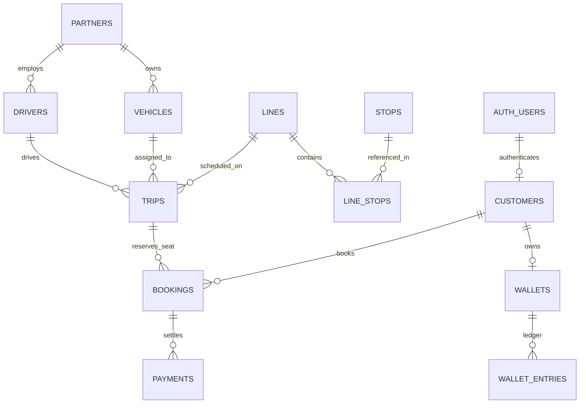

# Documentation du Jeu de Données de Test (JDD) - JELANI

> **Version** : 1.0  
> **Date de référence** : 25 octobre 2026  
> **Fichiers sources associés** :
> - Script d'injection SQL : [`local_db/03_test_dataset.sql`](file:///c:/workspaces/Jelani/minibus-booking-backend/local_db/03_test_dataset.sql)
> - Script d'automatisation PowerShell : [`scripts/seed-test-data.ps1`](file:///c:/workspaces/Jelani/minibus-booking-backend/scripts/seed-test-data.ps1)
> - Script de validation en direct : [`scripts/verify_test_dataset.py`](file:///c:/workspaces/Jelani/minibus-booking-backend/scripts/verify_test_dataset.py)

---

## 1. Contexte & Objectif

À la suite de l'**Audit Mobile MVP v1 (27 août 2026)** et de la mise en œuvre des règles de gestion d'inventaire périssable (Sprint 1), ce jeu de données (JDD) a été conçu pour :

1. **Permettre la recette fonctionnelle immédiate sur l'application mobile** (iOS / Android) sans devoir créer manuellement des données.
2. **Couvrir 100 % des états du cycle de vie métier** :
   - Trajets (`scheduled`, `boarding`, `completed`, `cancelled`).
   - Réservations (`pending` actif, `expired`, `confirmed`, `boarded`, `completed`, `cancelled`).
   - Paiements (`pending`, `paid`, `refunded`, `refund_required`).
3. **Respecter la comptabilité à partie double du Wallet** (aucun solde artificiel sans écriture d'ajustement conforme dans `wallet_entries`).
4. **Garantir l'idempotence et la réentrance** : le script peut être exécuté indéfiniment sans risque de doublons ou de ruptures de clés étrangères.

---

## 2. Modèle Relationnel & Alignement des Entités



---

## 3. Répertoire des Comptes Utilisateurs

Tous les comptes ont été créés avec le même mot de passe universel pour simplifier les tests manuels et automatisés :
* **Mot de passe brut** : `Password123!`
* **Hash Bcrypt stocké** : `$2b$12$b1U49zKvNOPCTPe/xxkN4O23JkJ3D0i2XaOTBYNQ1jXqkFJ2ka1xK`

### 3.1. Profil Client Principal (Recette Mobile & Wallet)
* **Customer ID** : `88888888-8888-8888-8888-888888888881`
* **Auth User ID** : `99999999-9999-9999-9999-999999999991`
* **Identité** : Jean Kouassi
* **Téléphone (Login)** : `+2250101010101`
* **Email** : `jean.kouassi@jelani.test`
* **Solde Wallet initial** : **50 000 FCFA** (alimenté via écriture `adjustment` dans `wallet_entries`)
* **Usage** : C'est le compte principal de démonstration. En vous connectant avec ce numéro sur l'application mobile, vous disposez immédiatement des 7 états de réservation possibles dans l'onglet **"Mes Réservations"** et pouvez tester le paiement instantané par portefeuille.

### 3.2. Profil Client Sans Solde (Test Paiements Externes)
* **Customer ID** : `88888888-8888-8888-8888-888888888882`
* **Auth User ID** : `99999999-9999-9999-9999-999999999992`
* **Identité** : Marie Amani
* **Téléphone (Login)** : `+2250202020202`
* **Email** : `marie.amani@jelani.test`
* **Solde Wallet initial** : **0 FCFA**
* **Usage** : Test des flux de rechargement de wallet ou d'initiation de paiement externe Mobile Money (Jèko / Wave / MTN / Orange) en cas de solde insuffisant.

### 3.3. Profil Opérateur / Contrôleur de Gare (Validation des Billets)
* **Customer ID** : `88888888-8888-8888-8888-888888888883`
* **Auth User ID** : `99999999-9999-9999-9999-999999999993`
* **Identité** : Seydou Contrôleur
* **Téléphone (Login)** : `+2250303030303`
* **Email** : `seydou.controleur@jelani.test`
* **Provisionnement Serveur** : ID à déclarer dans la variable d'environnement `TICKET_SCANNER_CUSTOMER_IDS`
* **Usage** : Utilisateur habilité à exécuter `POST /api/bookings/ticket/<ref>/consume` pour valider l'embarquement physique d'un passager.

---

## 4. Réseau de Transport (Lignes, Arrêts et Flotte)

### 4.1. Lignes
1. **`ABJ-YAM`** (`44444444-4444-4444-4444-444444444444`) : *Abidjan - Yamoussoukro* (Interurbain)
   - Prix par défaut : 5 000 FCFA
   - Arrêts :
     1. `Gare Nord` (Adjamé, Abidjan)
     2. `Tiébissou Centre` (+110 min)
     3. `Gare Yamoussoukro` (+180 min)
2. **`YOP-PLA`** (`44444444-4444-4444-4444-444444444445`) : *Yopougon Siporex - Plateau Postel* (Navette Urbaine Express)
   - Prix par défaut : 1 000 FCFA
   - Arrêts :
     1. `Siporex` (Yopougon)
     2. `Carrefour Liberté` (Adjamé, +25 min)
     3. `Postel 2001` (Plateau, +45 min)

### 4.2. Flotte et Chauffeurs
* **Véhicule 1** : Toyota Hiace (18 places) - Immatriculation `AB-123-CD` (Code `JEL-001`)  
  *Chauffeur* : Moussa Kone (`+2250100000002`)
* **Véhicule 2** : Mercedes Sprinter VIP (14 places) - Immatriculation `CI-456-EF` (Code `VIP-002`)  
  *Chauffeur* : Bakary Touré (`+2250100000005`)

---

## 5. Trajets de Test (Matrice des Cas Métier)

Les dates sont calculées dynamiquement lors de l'insertion pour rester toujours synchronisées avec le moment où vous testez :

| ID Trajet | Ligne | Départ Prévu | Vente Clôturée (`booking_close_at`) | Statut | Places Dispo | Scénario Validé |
| :--- | :--- | :--- | :--- | :--- | :--- | :--- |
| `7777...7701` | `ABJ-YAM` | Demain à 08:00 UTC | Demain à 07:30 UTC | `scheduled` | 16 / 18 | **Achat normal** : Visible en recherche, réservable et payable |
| `7777...7702` | `YOP-PLA` | Aujourd'hui + 5 min | Passée il y a 5 min | `boarding` | 12 / 14 | **Embarquement en cours** : Ventes closes, fenêtre de scan ouverte |
| `7777...7703` | `ABJ-YAM` | Il y a 2 jours | Il y a 2 jours | `completed` | 18 / 18 | **Trajet passé (Audit P0)** : Rejet absolu en recherche et à la réservation |
| `7777...7704` | `YOP-PLA` | Dans 2 jours à 14:00 | Dans 2 jours à 13:30 | `scheduled` | **0** / 14 | **Trajet complet** : Rejet de surbooking |
| `7777...7705` | `ABJ-YAM` | Dans 3 jours à 09:00 | Dans 3 jours à 08:30 | `cancelled` | 18 / 18 | **Trajet annulé** : Rejet de réservation |

---

## 6. Réservations & Titres de Transport (Compte Jean Kouassi)

Toutes ces réservations sont rattachées à Jean Kouassi (`+2250101010101`).

```
                              CYCLE DE VIE DU TITRE DE TRANSPORT
                              
  [ PENDING ] ──────────( 15 min )──────────> [ EXPIRED ] (Libération des sièges)
       │
       │ Paiement
       ▼
  [ CONFIRMED ] ──────( Fenêtre Départ )───> [ BOARDING ] (Prêt pour scan)
                                                    │
                                                    │ Scan QR Code Serveur
                                                    ▼
                                             [ BOARDED ] (Billet consommé à usage unique)
                                                    │
                                                    ▼
                                             [ COMPLETED ] (Historique)
```

| Référence Billet | Statut Booking | Statut Paiement | Statut Voyage | Statut Billet | Permissions API | Rendu Attendu sur l'App Mobile |
| :--- | :--- | :--- | :--- | :--- | :--- | :--- |
| `JELANI-TEST-PENDING-ACTIVE` | `pending` | `pending` | `upcoming` | `none` | `can_pay=true`<br>`can_cancel=true`<br>`can_show_ticket=false` | **Onglet "À payer"** : Compte à rebours actif (~12 min), bouton *Payer* et *Annuler* visibles |
| `JELANI-TEST-EXPIRED` | `expired` | `pending` | `expired` | `expired` | `can_pay=false`<br>`can_cancel=false`<br>`can_show_ticket=false` | **Onglet "Historique"** : Libellé *Expiré*, bouton *Payer* masqué, places libérées |
| `JELANI-TEST-UPCOMING` | `confirmed` | `paid` | `upcoming` | `valid` | `can_pay=false`<br>`can_cancel=true`<br>`can_show_ticket=true` | **Onglet "À venir"** : Billet prêt, bouton *Afficher Ticket QR* fonctionnel |
| `JELANI-TEST-BOARDING` | `confirmed` | `paid` | `boarding` | `valid` | `can_pay=false`<br>`can_cancel=false`<br>`can_show_ticket=true` | **Onglet "À venir"** : Statut *Embarquement*, prêt à être présenté au contrôleur |
| `JELANI-TEST-BOARDED` | `boarded` | `paid` | `boarded` | `used` | `can_pay=false`<br>`can_cancel=false`<br>`can_show_ticket=false` | **Onglet "Historique"** : Statut *Déjà utilisé*, pas de QR code actif |
| `JELANI-TEST-COMPLETED` | `completed` | `paid` | `completed` | `expired` | `can_pay=false`<br>`can_cancel=false`<br>`can_show_ticket=false` | **Onglet "Historique"** : Trajet terminé il y a 2 jours, vue d'archive |
| `JELANI-TEST-CANCELLED` | `cancelled` | `refunded` | `cancelled` | `void` | `can_pay=false`<br>`can_cancel=false`<br>`can_show_ticket=false` | **Onglet "Annulés"** : Statut *Annulé et remboursé* |

---

## 7. Protocoles de Test & Validation

### Test 1 : Rejet d'un Achat sur Trajet Passé (Audit P0)
* **Endpoint** : `POST /api/bookings`
* **Payload** :
  ```json
  {
    "trip_id": "77777777-7777-7777-7777-777777777703",
    "number_of_seats": 1,
    "pickup_stop_id": "55555555-5555-5555-5555-555555555551",
    "dropoff_stop_id": "55555555-5555-5555-5555-555555555553"
  }
  ```
* **Résultat attendu** : `HTTP 400 Bad Request` avec `{"error": "Trip is not available for booking"}`.

### Test 2 : Validation d'Embarquement par l'Opérateur (Scan QR)
* **JWT** : Généré pour Seydou Contrôleur (`+2250303030303`)
* **Endpoint** : `POST /api/bookings/ticket/JELANI-TEST-BOARDING/consume`
* **Payload** :
  ```json
  {
    "trip_id": "77777777-7777-7777-7777-777777777702"
  }
  ```
* **Résultat attendu au premier scan** : `HTTP 200 OK` (Billet consommé, statut passe à `boarded`).
* **Résultat attendu au second scan** : `HTTP 409 Conflict` avec `{"code": "TICKET_ALREADY_USED", "error": "Ticket already boarded"}`.

### Test 3 : Refus de Paiement sur Réservation Expirée
* **Endpoint** : `POST /api/payments/initiate`
* **Payload** :
  ```json
  {
    "booking_id": "bbbbbbbb-bbbb-bbbb-bbbb-bbbbbbbbbbb2"
  }
  ```
* **Résultat attendu** : `HTTP 409 Conflict` avec `{"code": "BOOKING_EXPIRED", "error": "Booking is no longer payable"}`.

---

## 8. Maintenance & Exploitation du JDD

### Réinjecter les données
Pour réinitialiser la base locale à cet état propre à tout moment :
```powershell
.\scripts\seed-test-data.ps1
```

### Vérifier l'état en direct
Pour lancer la vérification automatique des endpoints sans interface :
```bash
docker exec minibus_local_backend python scripts/verify_test_dataset.py
```
Ce script contrôle automatiquement :
1. La connexion avec le compte Jean Kouassi.
2. La conformité des 7 réservations retournées.
3. La consultation publique de métadonnées du billet.
4. Le filtrage des trajets en recherche.
